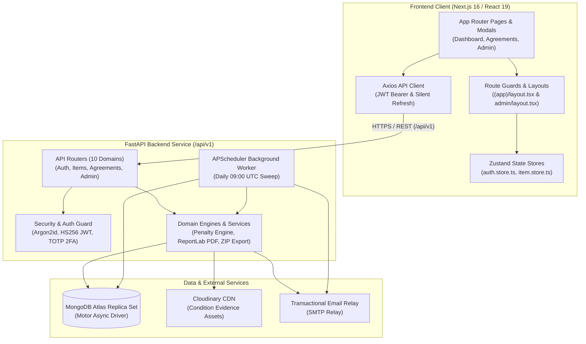
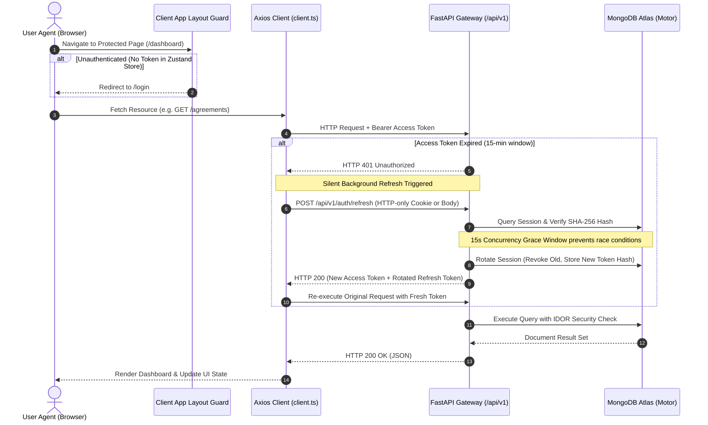
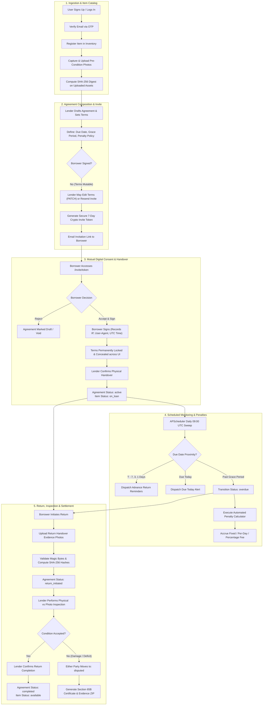
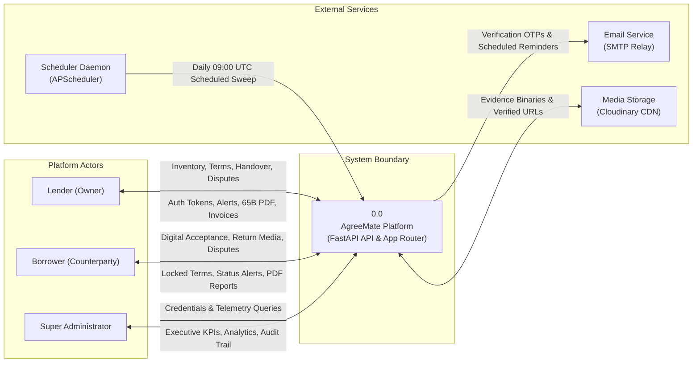
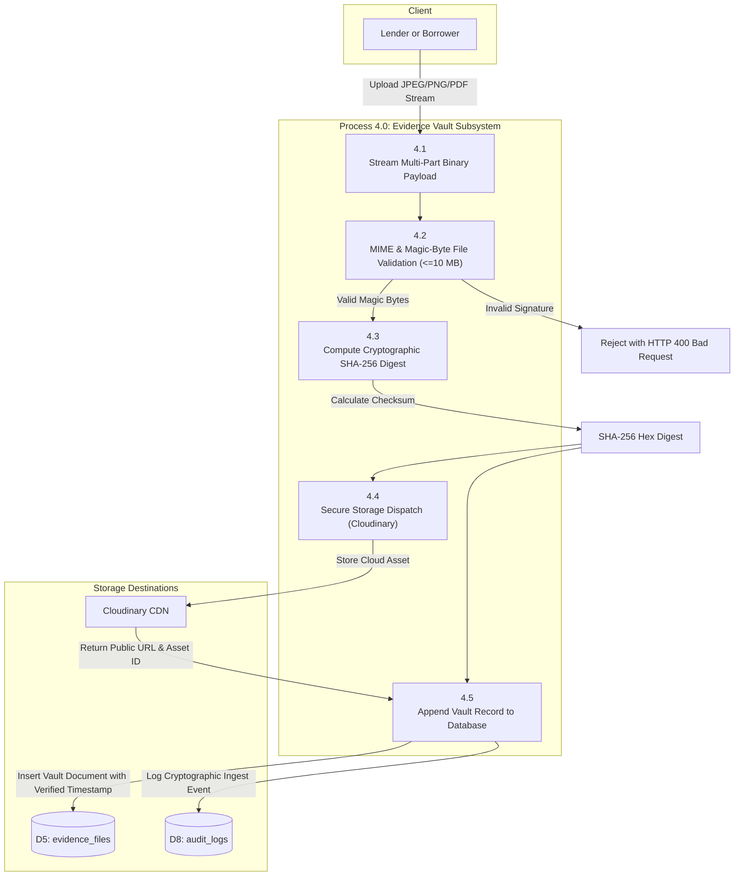
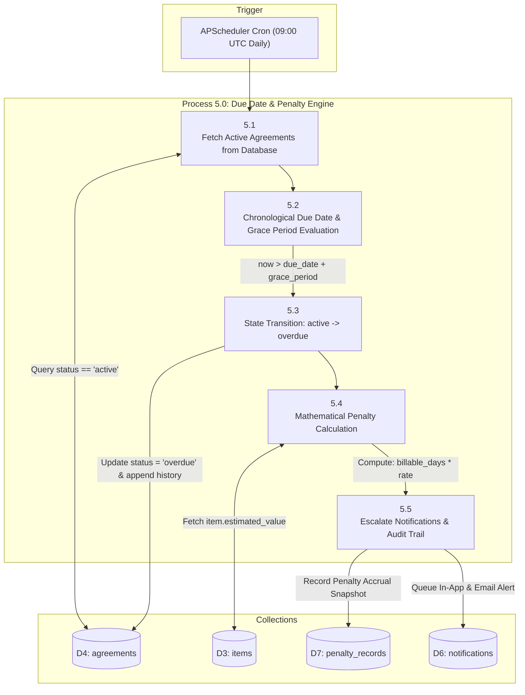
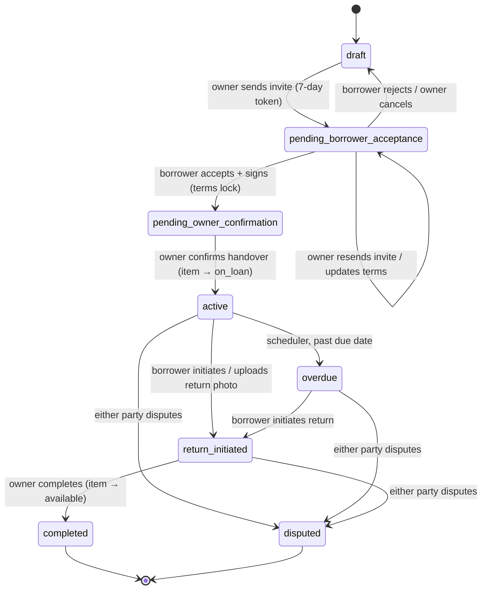
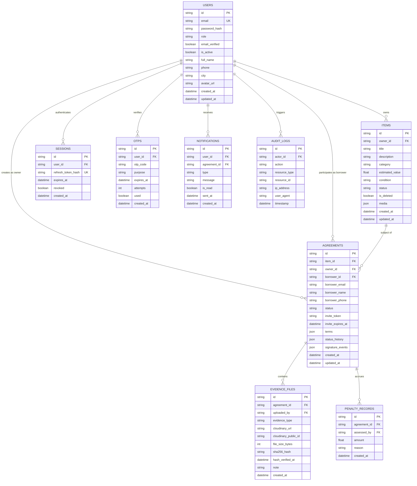

# AgreeMate — Complete Project Documentation

> **Lend with Trust. Borrow with Proof.**
> A mutual-consent, evidence-backed lending platform for physical items.

---

## Table of Contents

1. [Abstract](#1-abstract)
2. [Introduction & Problem Statement](#2-introduction--problem-statement)
3. [Objectives & Scope](#3-objectives--scope)
4. [Target Users](#4-target-users)
5. [System Architecture](#5-system-architecture)
6. [Agreement Lifecycle (State Machine)](#6-agreement-lifecycle-state-machine)
7. [Data Model](#7-data-model)
8. [API Reference](#8-api-reference)
9. [Technology Stack](#9-technology-stack)
10. [Security Architecture](#10-security-architecture)
11. [Testing Strategy](#11-testing-strategy)
12. [Setup & Deployment Guide](#12-setup--deployment-guide)
13. [Known Limitations & Future Work](#13-known-limitations--future-work)
14. [References](#14-references)

---

## 1. Abstract

Informal lending between people — a friend borrowing a camera, a shopkeeper lending a
drill, a studio renting out a lens — happens constantly and almost always without a
record. When the item comes back damaged, late, or not at all, there is no proof of what
was agreed, no proof of the item's original condition, and no recourse beyond an awkward
conversation.

**AgreeMate** is a full-stack web application that turns these handshake deals into
verifiable, dual-signed agreements. Every item is captured with photos that are
cryptographically hashed (SHA-256) at the moment of upload, creating a tamper-evident
record of condition. Both parties must digitally sign before an agreement becomes active,
each signature stamped with IP address and timestamp. Overdue returns accrue penalties
automatically, reminders are sent on a schedule, and if a dispute arises the entire audit
trail can be exported as a lawyer-ready PDF and evidence packet.

Positioned against existing tools, AgreeMate fills a specific gap: expense trackers like
KhataBook record *money*, not *items*; single-sided apps like Borrowed or Keepfully let
one person track what they lent but capture no mutual consent and no evidence. AgreeMate
is a **dual-sided, evidence-backed lending platform** — both parties see and agree to the
same terms, and the record is designed to stand up when trust breaks down.

---

## 2. Introduction & Problem Statement

Every lending story tends to end the same way:

- A ₹80,000 DSLR comes back with a cracked lens — and no photo proving it was fine when it left.
- A power tool gets taken out of town for "a weekend" and is gone for a month.
- A roommate hangs on to a borrowed laptop for three weeks while you keep not-quite-asking for it back.

The common thread is **no proof, no record, no recourse.** Lending between people who
trust each other relies on memory and hope. The moment something goes wrong, there is
nothing objective to point to — not the agreed return date, not the condition at handover,
not even a clear record that a loan happened at all.

AgreeMate replaces "memory and hope" with a structured, mutually-agreed, evidence-backed
record. It keeps friendly lending friendly by making the terms explicit up front and the
evidence indisputable after the fact — so nobody has to rely on their word against
someone else's.

---

## 3. Objectives & Scope

### Primary objectives

1. **Mutual consent** — no agreement is binding until both the lender and borrower have signed the *same* terms.
2. **Tamper-evident evidence** — every uploaded file is SHA-256 hashed on ingest so any later alteration is detectable.
3. **Automated accountability** — penalties for overdue returns are computed by the system, not negotiated in the moment.
4. **Dispute readiness** — a complete, exportable audit trail (agreement, signatures, evidence hashes) exists for every deal.
5. **Low friction** — the core loop (capture → terms → sign → track) is designed to be faster than writing anything down by hand.

### In scope (built)

- Email + password authentication with OTP email verification.
- JWT access/refresh token sessions with silent refresh and rotation.
- Item inventory (CRUD, soft delete, condition/status lifecycle).
- Full agreement lifecycle with a strict state machine and dual signatures.
- **Invitation lifecycle & terms editing**: Resend invite email with fresh token, copy direct URL, edit terms before borrower signing (`PATCH /agreements/{id}`), and post-acceptance UI concealment.
- **Dedicated Executive Admin Portal**: Independent `/admin` command center & `/admin/login` gateway with live KPI metrics, SVG monthly velocity bar graph, SVG status donut chart, registered accounts directory, and master agreement ledger.
- **Indian Legal Compliance**: Embedded Section 65B Electronic Record Certificate (Indian Evidence Act, 2000 / Section 63 BSA 2023) with SHA-256 cryptographic checksums on viewer and PDF.
- **ISO A4 Tax Invoice Generator**: GSTIN breakdown, itemized line items (SAC codes 998313/998314/998315), digital invoice hash, and direct PDF streaming.
- SHA-256 evidence upload with MIME + magic-byte validation.
- Penalty engine (fixed / per-day / percentage) with lender override.
- In-app notification feed.
- Scheduled **email** reminders (7 / 3 / 1 day before due, due-today, overdue).
- PDF + ZIP evidence-packet export.
- Database clean & seed engine (`clean_and_seed_admin.py`).

### Out of scope (not built — see [§13](#13-known-limitations--future-work))

WhatsApp reminders, in-app payments (Razorpay/UPI), identity KYC (Onfido), and Hindi localisation are described in the product vision and marketing copy but are **not** implemented in the current codebase. They are documented honestly as future work rather than presented as shipped features.

---

## 4. Target Users

AgreeMate targets informal and semi-formal lending in India, across five segments:

| Segment | Typical loan | What they need |
|---|---|---|
| **Students** | Hostel/college gear, electronics, books | Quick, low-friction agreements between peers |
| **Shopkeepers** | Tools, equipment, appliances | Simple records without accounting overhead |
| **Studios** | Cameras, lenses, lighting rigs | High-value gear with condition evidence |
| **Small Business** | B2B assets, shared inventory | Traceable asset hand-offs between staff/partners |
| **Cash Lenders** | Informal loans (interest models) | Clear terms and a dispute-ready paper trail |

Geographic focus is India (Mumbai, Pune, Bangalore, Delhi, Chennai), reflected in ₹ (INR)
currency throughout the penalty engine and pricing.

---

## 5. System Architecture

AgreeMate is a production dual-tier platform: a Next.js 16 frontend (`frontend/`) deployed on Vercel communicating with an asynchronous Python 3.12+ FastAPI backend (`backend/`) on Render/Cloud over a versioned REST API (`/api/v1`), backed by MongoDB Atlas.

A root development runner (`run.py`) provides unified process supervision, port collision avoidance, health probing, and optional Cloudflare tunneling for local mobile/webhook testing.



### 5.1 Request & Authentication Flow

Access tokens are short-lived (15 minutes, stateless HS256 JWT); refresh tokens (7 days) are cryptographically hashed using SHA-256 before storage in the `sessions` collection and rotated upon every refresh invocation. 

In production, cross-origin cookies use `SameSite=None; Secure=True` so sessions persist smoothly between Vercel and cloud backends. A 15-second concurrency grace window on token rotation prevents race conditions from concurrent browser requests. The Axios client performs **silent refresh** on HTTP `401 Unauthorized` or approaching expiration, queuing concurrent in-flight requests behind a single refresh promise:



---

### 5.2 End-to-End Lending Lifecycle Flowchart

The following flowchart details the end-to-end mutual lending process, highlighting dual digital consent, terms immutability, automated penalty execution, and dispute resolution:



---

### 5.3 Data Flow Diagram — Level 0 (Context Diagram)

The Level 0 Context Diagram depicts the AgreeMate platform boundary and its interactions with actors and external services:



---

### 5.4 Data Flow Diagram — Level 1 (Subsystems & Data Stores)

The Level 1 diagram decomposes AgreeMate into its 8 core processes and 8 MongoDB data stores:

```mermaid
flowchart TB
    subgraph External["External Entities"]
        LENDER["Lender"]
        BORROWER["Borrower"]
        ADMIN["Administrator"]
        MAIL["SMTP Email Server"]
        CDN["Cloudinary CDN"]
        CLOCK["APScheduler Cron"]
    end

    subgraph Processes["Platform Subsystems"]
        P1["1.0<br/>Authentication & Session Authority"]
        P2["2.0<br/>Item Inventory Management"]
        P3["3.0<br/>Agreement & Dual-Signing Engine"]
        P4["4.0<br/>Evidence Vault & SHA-256 Ingestion"]
        P5["5.0<br/>Scheduled Sweep & Penalty Calculator"]
        P6["6.0<br/>Notification Dispatcher"]
        P7["7.0<br/>Legal Certificate & Invoice Generator"]
        P8["8.0<br/>Executive Admin & Audit Logging"]
    end

    subgraph Stores["MongoDB Collections"]
        D1[("D1: users")]
        D2[("D2: otps & sessions")]
        D3[("D3: items")]
        D4[("D4: agreements")]
        D5[("D5: evidence_files")]
        D6[("D6: notifications")]
        D7[("D7: penalty_records")]
        D8[("D8: audit_logs")]
    end

    %% 1.0 Auth
    LENDER & BORROWER & ADMIN -->|Credentials| P1
    P1 <-->|Read / Write Users| D1
    P1 <-->|Store Sessions & Verify OTPs| D2
    P1 -->|Deliver OTPs| MAIL

    %% 2.0 Items
    LENDER -->|Item Data & Specs| P2
    P2 <-->|CRUD Items| D3

    %% 3.0 Agreements
    LENDER -->|Terms & Handover| P3
    BORROWER -->|Accept & Sign| P3
    P3 <-->|Lock Terms & Signatures| D4
    P3 <-->|Sync available / on_loan Status| D3
    P3 -->|Trigger Notification Event| P6

    %% 4.0 Evidence
    LENDER & BORROWER -->|Evidence Upload| P4
    P4 -->|Store Payloads| CDN
    P4 -->|Persist SHA-256 Checksums| D5
    P4 -.->|Associate with Contract| D4

    %% 5.0 Penalties & Scheduler
    CLOCK -->|Daily Sweep Trigger| P5
    P5 <-->|Inspect Active Loans| D4
    P5 <-->|Fetch Item Value| D3
    P5 -->|Record Penalty Accrual| D7
    P5 -->|Queue Overdue Notices| P6

    %% 6.0 Notifications
    P6 -->|Write Feed Entries| D6
    P6 -->|Send SMTP Reminder Emails| MAIL
    D6 -->|Read Notification Feed| LENDER & BORROWER

    %% 7.0 Legal & Invoices
    LENDER & BORROWER -->|Request Export| P7
    P7 <-->|Fetch Contract & Signatures| D4
    P7 <-->|Fetch Evidence Hashes| D5
    P7 <-->|Fetch User / Item Context| D1 & D3
    P7 -->|Stream Section 65B PDF / Tax Invoice| LENDER & BORROWER

    %% 8.0 Admin & Audit
    ADMIN -->|Inspect Telemetry| P8
    P8 <-->|Aggregate Metrics| D1 & D3 & D4
    P8 <-->|Write & Read Security Logs| D8
```



---

### 5.5 Data Flow Diagram — Level 2 (Detailed Functional Decompositions)

#### DFD Level 2.1: Agreement State Lifecycle & Dual Digital Signing

```mermaid
flowchart TD
    subgraph Inputs["Actors"]
        L["Lender (Owner)"]
        B["Borrower"]
    end

    subgraph Subsystem3["Process 3.0: Agreement Lifecycle Engine"]
        P3_1["3.1<br/>Compose Agreement & Formulate Terms"]
        P3_2["3.2<br/>Generate Cryptographic Token & Invite"]
        P3_3["3.3<br/>Verify Token & Ingest Borrower Digital Signature"]
        P3_4["3.4<br/>Execute Mutual Terms Lock & UI Concealment"]
        P3_5["3.5<br/>Lender Handover Sign & Status Transition"]
    end

    subgraph Data["Data Stores"]
        D4[("D4: agreements")]
        D3[("D3: items")]
        D6[("D6: notifications")]
    end

    L -->|Submit Item ID, Dates, Penalty Policy| P3_1
    P3_1 -->|Insert draft Record| D4
    P3_1 -->|Trigger Invitation| P3_2
    P3_2 -->|Generate 7-Day Crypto Token & Update| D4
    P3_2 -->|Send Email & Queue Notification| D6
    B -->|Submit Digital Signature with IP & User-Agent| P3_3
    P3_3 -->|Append Signature Event & Set pending_owner_confirmation| D4
    P3_3 -->|Trigger Immutability Guard| P3_4
    P3_4 -->|Lock Terms (locked_at = now)| D4
    L -->|Confirm Handover Handshake| P3_5
    P3_5 -->|Append Lender Handover Signature & Set active| D4
    P3_5 -->|Atomic Update: status = on_loan| D3
```

#### DFD Level 2.2: Evidence Vault & SHA-256 Cryptographic Ingestion



#### DFD Level 2.3: Automated Due Date Monitoring & Penalty Calculation Engine



---

### 5.6 Production Repository Layout

```text
AgreeMate-Project/
├── api/
│   ├── index.py                  # Vercel adapter for the FastAPI application
│   └── requirements.txt          # Self-contained deployment dependencies
├── backend/
│   ├── app/
│   │   ├── core/                 # Settings, CORS and security headers
│   │   ├── db/                   # MongoDB client and index definitions
│   │   ├── modules/              # Auth, users, agreements, items, evidence,
│   │   │                         # penalties, notifications, reminders, security, admin
│   │   ├── services/             # SMTP, Cloudinary, PDF and ZIP generation
│   │   ├── jobs/                 # Reminder execution
│   │   ├── dependencies.py       # Authentication/authorization dependencies
│   │   └── main.py               # FastAPI application and route registration
│   ├── scripts/                  # Database administration utilities
│   ├── tests/                    # Unit, integration and security tests
│   └── requirements.txt          # Canonical Python runtime dependencies
├── frontend/
│   ├── src/
│   │   ├── app/                  # Next.js routes, layouts and global CSS
│   │   ├── components/           # Shared UI, layouts, providers and landing sections
│   │   ├── features/agreements/  # Agreement UI and wizard
│   │   ├── stores/               # Shared Zustand stores
│   │   ├── hooks/                # Shared React hooks
│   │   └── lib/                  # HTTP clients and utilities
│   ├── public/                   # Application icons, images and videos
│   └── tests/                    # Frontend tests
├── infrastructure/docker/        # Frontend and backend Dockerfiles
├── scripts/                      # Health, seeding and repository checks
├── docs/                         # Project documentation
├── .github/                      # CI and contribution templates
├── docker-compose.yml            # Local frontend, backend and MongoDB services
├── package.json                  # npm workspace and developer commands
├── package-lock.json             # Single npm workspace lockfile
├── requirements.txt              # Self-contained deployment dependencies
├── run.py                        # Local development supervisor
└── vercel.json                   # Hosting routes and reminder cron
```

### 5.7 Component Responsibilities

| Location | Responsibility |
| --- | --- |
| `api/index.py` | Exports the existing FastAPI app for Vercel. It contains no separate business logic. |
| `backend/app/main.py` | Assembles domain routers, middleware, lifecycle and health endpoints. |
| `backend/app/modules/` | Domain API handlers, validation schemas and business logic. |
| `backend/app/services/` | Shared SMTP delivery, storage integration, agreement PDF and evidence ZIP generation. |
| `backend/app/jobs/reminders.py` | Reminder execution shared by scheduler and cron routes. |
| `frontend/src/lib/api/` | HTTP clients calling the backend. This is not a second API server. |
| `frontend/src/stores/` | One shared instance of each client state store. |
| `frontend/src/features/agreements/` | Agreement views, previews and creation wizard. |
| `frontend/src/components/` | Shared UI, application layouts and landing-page components. |

Production requests follow: browser HTTP client → `/api/v1/...` → Vercel adapter → FastAPI router. Local development runs the same FastAPI app directly with Uvicorn. There is no second backend API directory.

Use the [repository structure guide](architecture/repository-structure.md) for directory ownership and the [root README](../README.md) for installation and test commands.

---

## 6. Agreement Lifecycle (State Machine)


The agreement lifecycle is the heart of the domain. Transitions are enforced in
`backend/app/agreements/router.py`; every transition is appended to `status_history`, and
the accept/confirm steps append signed `signature_events` (with IP + user-agent).



**Notes**
- **Invitation Resend & Direct URL**: The lender can resend the borrower invite anytime while in `pending_borrower_acceptance` via `POST /agreements/{id}/invite`, generating a fresh 7-day token and re-emailing the borrower. The lender can also copy the direct invitation URL.
- **Terms Editing**: Before borrower signing, the lender can update terms (dates, penalties, borrower contact details) via `PATCH /agreements/{id}`.
- **Mutual Consent Lock & Concealment**: Terms are **permanently locked** once the borrower signs/accepts. At this point, all invitation links, resend triggers, and terms editing forms are automatically concealed across the UI.
- Handover confirmation uses a MongoDB atomic condition (`status: "available" → "on_loan"`) to prevent double-lending under high concurrency.
- Any participant can move a non-draft, non-completed agreement to `disputed`.
- The daily scheduler transitions `active → overdue` and auto-marks notifications for completed agreements as read.

---

## 7. Data Model

AgreeMate utilizes MongoDB as its primary persistence engine, accessed asynchronously via the **Motor** driver without an ODM. Document shapes are enforced and validated strictly at API and service boundaries using **Pydantic v2** models.

### 7.1 Entity-Relationship Model (MongoDB)

The data model follows modern document database design principles:
- **Top-Level Collections:** Independent entities (`users`, `items`, `agreements`, `audit_logs`) and bounded relational entities (`sessions`, `otps`, `evidence_files`, `notifications`, `penalty_records`).
- **Embedded Sub-Documents:** Atomic, high-locality structures (`terms`, `signature_events`, `status_history`, `item.media`) embedded directly within parent documents for single-operation atomic reads and transactional state transitions without costly multi-document joins.



#### Embedded Value Objects (Embedded Document Schemas)

| Embedded Structure | Parent Document | Key Fields | Purpose |
|---|---|---|---|
| `terms` | `agreements` | `due_date`, `penalty_type`, `penalty_rate`, `grace_period_days`, `special_conditions`, `locked_at`, `created_at` | Immutable terms once counterparty signs |
| `signature_events` | `agreements` | `id`, `user_id`, `event_type`, `ip_address`, `user_agent`, `created_at` | Section 65B tamper-evident digital signature audit trail |
| `status_history` | `agreements` | `from_status`, `to_status`, `changed_by`, `note`, `created_at` | Complete chronological lifecycle audit trail |
| `media` | `items` | `cloudinary_url`, `public_id`, `is_primary`, `uploaded_at` | Item pre-condition imagery array |

### 7.2 Database Collections & Physical Schemas

Database name: `agreemate`. Eight primary collections:

| Collection | Entity Type | Identifying Parent | Key Indexes |
|---|---|---|---|
| `users` | Strong Entity | None | `email` (Unique) |
| `otps` | Weak Entity | `users` | `(user_id, created_at)`, `expires_at` (TTL = 0s) |
| `sessions` | Weak Entity | `users` | `refresh_token_hash`, `(user_id, revoked, created_at)`, `expires_at` (TTL = 0s) |
| `items` | Strong Entity | `users` (ref) | `(owner_id, is_deleted)` |
| `agreements` | Strong Entity | `users` / `items` (ref) | `(owner_id, created_at)`, `(borrower_id, created_at)`, `invite_token`, `status` |
| `evidence_files` | Weak Entity | `agreements` | `(agreement_id, created_at)` |
| `notifications` | Weak Entity | `users` | `(user_id, is_read, created_at)` |
| `penalty_records` | Weak Entity | `agreements` | `(agreement_id, created_at)` |
| `audit_logs` | Strong Entity | None | `(actor_id, timestamp)` |

### users
```jsonc
{
  "_id": "ObjectId",
  "email": "user@example.com",     // unique
  "password_hash": "argon2...",     // Argon2id
  "role": "user",                  // "user" | "admin"
  "email_verified": true,
  "is_active": true,
  "full_name": "Amit Sharma",
  "phone": "+91...",
  "city": "Pune",
  "avatar_url": null,
  "created_at": "ISODate",
  "updated_at": "ISODate"
}
```
Supporting: **otps** (`otp_code`, `purpose`, `expires_at`, `attempts`, `used`),
**sessions** (`refresh_token_hash`, `expires_at`, `revoked`).

### items
```jsonc
{
  "_id": "ObjectId",
  "owner_id": "ObjectId",
  "title": "MacBook Pro 16\"",
  "description": "2023, space grey",
  "category": "electronics",
  "estimated_value": 250000.0,        // required for percentage penalties
  "condition": "good",                 // new | good | fair | poor
  "status": "available",               // available | on_loan | ...
  "is_deleted": false,
  "media": [{ "cloudinary_url": "...", "is_primary": true }],
  "created_at": "ISODate",
  "updated_at": "ISODate"
}
```

### agreements
```jsonc
{
  "_id": "ObjectId",
  "item_id": "ObjectId",
  "owner_id": "ObjectId",
  "borrower_id": "ObjectId | null",
  "borrower_email": "borrower@example.com",
  "borrower_name": "Priya Patel",
  "borrower_phone": "+91 98765 43210",
  "status": "active",
  "invite_token": "…",
  "invite_expires_at": "ISODate",
  "terms": {
    "due_date": "ISODate",
    "penalty_type": "per_day",         // fixed | per_day | percentage
    "penalty_rate": 50,
    "grace_period_days": 1,
    "special_conditions": null,
    "locked_at": "ISODate",
    "created_at": "ISODate"
  },
  "status_history": [{ "status": "...", "at": "ISODate", "by": "ObjectId" }],
  "signature_events": [{
    "id": "…", "user_id": "ObjectId",
    "event_type": "borrower_accepted",  // or owner_confirmed
    "ip_address": "…", "user_agent": "…", "created_at": "ISODate"
  }],
  "created_at": "ISODate",
  "updated_at": "ISODate"
}
```

### evidence_files
```jsonc
{
  "_id": "ObjectId",
  "agreement_id": "ObjectId",
  "uploaded_by": "ObjectId",
  "evidence_type": "return",
  "cloudinary_url": "…",               // mock until Cloudinary wired
  "cloudinary_public_id": "…",
  "file_size_bytes": 84213,
  "note": "…",
  "sha256_hash": "a3f2…",
  "hash_verified_at": "ISODate",
  "created_at": "ISODate"
}
```

### notifications & penalty_records
- **notifications**: `user_id`, `agreement_id`, `type` (`reminder_7d|reminder_3d|reminder_1d|due_today|overdue`), `message`, `is_read`, `sent_at`, `created_at`.
- **penalty_records**: lender override amount + `reason` (min 10 chars), persisted per agreement.

### Penalty calculation
```
billable_days = max(0, overdue_days − grace_period_days)
fixed       → penalty = penalty_rate
per_day     → penalty = penalty_rate × billable_days
percentage  → penalty = (penalty_rate% × item.estimated_value) / day × billable_days
```
Currency is ₹ (INR). A lender may override the computed amount with a written reason.

---

## 8. API Reference

Base URL: `/api/v1`. Auth via `Authorization: Bearer <access_token>` or HTTP-only refresh session cookie unless noted.
Health check endpoints at `GET /health/live` and `GET /health/ready` (pings MongoDB).

### Auth — `/auth`
| Method | Path | Body / Notes |
|---|---|---|
| POST | `/auth/signup` | `email`, `password`, `full_name` → creates inactive user, dispatches 6-digit OTP |
| POST | `/auth/verify-otp` | `email`, `otp_code` → activates account, marks `email_verified`, returns tokens |
| POST | `/auth/resend-otp` | `email` → dispatches new OTP (rate-limited, anti-enumeration) |
| POST | `/auth/login` | `email`, `password` → returns access + refresh tokens & sets secure cookie |
| POST | `/auth/refresh` | refresh token (cookie or body) → rotated access + refresh tokens (with 15s grace window) |
| POST | `/auth/logout` | revokes active session record in database |
| GET | `/auth/me` | returns current authenticated user profile context |

### Users — `/users`
| Method | Path | Notes |
|---|---|---|
| GET | `/users/me` | retrieves caller's profile metadata |
| PATCH | `/users/me` | updates `full_name`, `phone`, `city`, `avatar_url` |
| POST | `/users/me/avatar` | uploads profile picture to Cloudinary storage |
| GET | `/users/invoices/{invoice_id}/pdf` | downloads ISO A4 GST Tax Invoice PDF generated via ReportLab |

### Security & 2FA — `/security`
| Method | Path | Notes |
|---|---|---|
| POST | `/security/change-password` | updates password after verifying current password hash |
| POST | `/security/2fa/setup` | generates RFC 6238 TOTP secret & Base64 QR code image |
| POST | `/security/2fa/verify` | verifies 6-digit TOTP code and generates 8 emergency recovery backup codes |
| POST | `/security/2fa/disable` | disables 2FA upon valid TOTP or recovery backup code confirmation |
| GET | `/security/sessions` | lists all active user sessions with IP, user-agent, and creation date |
| DELETE | `/security/sessions/{session_id}` | revokes a specific user session |
| DELETE | `/security/sessions` | revokes all other sessions except the current one |
| GET | `/security/activity-log` | retrieves caller's security event audit log |

### Items — `/items`
| Method | Path | Notes |
|---|---|---|
| GET | `/items` | lists caller's registered items (paginated, filters out soft-deleted) |
| POST | `/items` | registers a new item (`title`, `description`, `category`, `estimated_value`, `condition`) |
| GET | `/items/{id}` | retrieves item details and pre-condition media |
| PATCH | `/items/{id}` | updates item specifications (locked if item is currently `on_loan`) |
| DELETE | `/items/{id}` | soft-deletes item (`is_deleted = true`, blocked if `on_loan`) |
| POST | `/items/{id}/media` | attaches pre-condition photo to item |

### Agreements — `/agreements`
| Method | Path | Notes |
|---|---|---|
| GET | `/agreements` | lists user's agreements (supports role filter: `owner`, `borrower`, `all`) |
| POST | `/agreements` | drafts new agreement linking item ID, counterparty email, due date, penalties |
| GET | `/agreements/dashboard-stats` | computes caller's dashboard counts (active, pending, completed, overdue) |
| GET | `/agreements/invite/{token}` | public counterparty inspection portal (validates 7-day token & terms) |
| POST | `/agreements/preview-pdf` | streams live preview of agreement terms before drafting |
| GET | `/agreements/{id}` | detailed agreement query (enforces IDOR participant security guard) |
| PATCH | `/agreements/{id}` | updates draft terms (allowed only before counterparty signs) |
| POST | `/agreements/{id}/invite` | sends or resends invitation email (generates fresh 7-day crypto token) |
| POST | `/agreements/{id}/accept` | counterparty digital acceptance (records IP, UA, UTC timestamp; locks terms) |
| POST | `/agreements/{id}/confirm` | lender confirms physical handover (status: `active`, item status: `on_loan`) |
| POST | `/agreements/{id}/return` | borrower initiates return handover and attaches return condition photos |
| POST | `/agreements/{id}/complete` | lender completes inspection (status: `completed`, item status: `available`) |
| POST | `/agreements/{id}/dispute` | flags damage or breach (status: `disputed`) |
| PATCH | `/agreements/{id}/dispute-resolve` | records settlement terms and closes dispute |
| POST | `/agreements/{id}/reject` | counterparty rejects invitation |
| POST | `/agreements/{id}/cancel` | owner cancels agreement prior to handover |
| GET | `/agreements/{id}/report/pdf` | downloads lawyer-ready Section 65B Certified Legal Agreement PDF |
| GET | `/agreements/{id}/report/zip` | downloads forensic ZIP packet with all evidence photos & `manifest.txt` |

### Penalties — `/penalties`
| Method | Path | Notes |
|---|---|---|
| GET | `/penalties/{agreement_id}/penalty` | calculates live accrued penalty using agreed formula & grace period |
| POST | `/penalties/{agreement_id}/penalty/override` | lender sets manual override amount (requires written reason >= 10 chars) |

### Evidence Vault — `/agreements/{id}/evidence`
| Method | Path | Notes |
|---|---|---|
| POST | `/agreements/{id}/evidence` | multipart binary upload (MIME + magic-byte check, <=10 MB, SHA-256 hashed) |
| GET | `/agreements/{id}/evidence` | lists all cryptographically verified evidence records for the agreement |
| GET | `/agreements/{id}/evidence/{evidence_id}/download` | secure audit-logged download proxy redirect to storage locator |

### Notifications — `/notifications`
| Method | Path | Notes |
|---|---|---|
| GET | `/notifications` | retrieves user notification feed (paginated) |
| PATCH | `/notifications/read-all` | marks all user notifications as read |
| PATCH | `/notifications/{id}/read` | marks a specific notification as read |

### Admin Command Center — `/admin` (Restricted to `role == "admin"`)
| Method | Path | Notes |
|---|---|---|
| POST | `/admin/login` | Super Admin gateway authentication (`admin@agreemate.io` / `ADMIN_INITIAL_PASSWORD`) |
| GET | `/admin/stats` | Executive telemetry: total valuation ₹, contracts count, registered users, risk exposure |
| GET | `/admin/charts` | Pure SVG aggregations: 6-month agreement velocity & lifecycle status distribution |
| GET | `/admin/users` | "Who Registered" live directory with keyword search and pagination |
| GET | `/admin/agreements` | Platform Master Contracts ledger with status filter and modal inspection |
| PATCH | `/admin/users/{user_id}/status` | updates user active status (`is_active = true/false`) |
| GET | `/admin/audit-logs` | global security audit trail of administrative and sensitive operations |
| GET | `/admin/system-health` | system runtime telemetry (memory, CPU, MongoDB connection status) |

---

## 9. Technology Stack

| Layer | Technology | Version & Details |
|---|---|---|
| Frontend framework | Next.js (App Router), React | Next.js 16, React 19, TypeScript 5 |
| Styling & Tokens | Tailwind CSS v4, Vanilla CSS variables | Curated dark/light theme tokens, responsive layouts |
| Client state | Zustand | `auth.store.ts` (persisted), `item.store.ts` |
| Data fetching | Axios + TanStack React Query | Silent JWT refresh interceptor, concurrency queue |
| Backend framework | FastAPI, Uvicorn | Python 3.12+, asynchronous ASGI service |
| Validation & Config | Pydantic v2, `pydantic-settings` | Strict schema validation & environment variable binding |
| Database | MongoDB Atlas | Motor async driver, TLS connection via `certifi` |
| Auth & Cryptography | JWT (HS256) + Argon2id / bcrypt | Short-lived access (15m), SHA-256 hashed rotated refresh (7d) |
| Two-Factor Auth | `pyotp` (RFC 6238 TOTP) | QR code synthesis via `qrcode` + emergency backup codes |
| PDF & Invoicing | ReportLab | Section 65B Legal Certificate PDF & ISO A4 GST Tax Invoice |
| Archive Bundler | Python stdlib `zipfile` + `hashlib` | Lawyer-ready evidence ZIP with SHA-256 `manifest.txt` |
| Due Date Scheduler | APScheduler (`AsyncIOScheduler`) | Daily 09:00 UTC sweep for return reminders & overdue penalties |
| Email Service | SMTP relay (Google SMTP) | Asynchronous HTML email dispatches (aiosmtplib) |
| Evidence Storage | Cloudinary CDN | Chunked streaming upload, MIME + magic-byte validation |
| Test Suites | pytest + pytest-asyncio, Vitest | 59 backend integration tests, 19 frontend Vitest tests |

---

## 10. Security Architecture

| Security Pillar | Technical Implementation |
|---|---|
| **Password Storage** | **Argon2id** password hashing (`argon2-cffi`) with bcrypt fallback — passwords are never stored in plaintext |
| **Session Security** | Short-lived access tokens (15 min) + refresh tokens (7 days) stored in the `sessions` collection as **SHA-256 hex hashes** |
| **Session Concurrency** | **15-second grace window** on refresh token rotation prevents race conditions from concurrent browser queries from prematurely revoking the session |
| **Cross-Origin Cookies** | In production, cookies configure `SameSite=None; Secure=True` to support cross-domain deployment (e.g., Vercel frontend to Render backend) |
| **Evidence Integrity** | Cryptographic **SHA-256 hash** calculated over raw binary bytes during ingest; `hash_verified_at` stored in append-only `evidence_files` collection |
| **Upload Safety** | **Magic-byte file header inspection** + MIME validation (JPEG, PNG, WebP, PDF only) + chunked 10 MB upload guard to eliminate DoS memory exhaustion |
| **Authorization (IDOR)** | Participant checks (`owner_id`, `borrower_id`, or authorized invite token) verified on every agreement, item, and evidence endpoint |
| **Two-Factor Auth** | RFC 6238 TOTP authentication with clock-drift tolerance and 8 one-time cryptographic recovery backup codes |
| **Brute-Force Guard** | 6-digit OTPs expire in 10 minutes, enforce a max 5-attempt limit, and provide anti-enumeration error responses |
| **Transport Security** | MongoDB TLS encryption via `certifi`; Security HTTP headers (`nosniff`, `DENY` clickjacking, strict referrer, restrictive permissions) |

Secrets (`MONGODB_URL`, `JWT_SECRET`, `SMTP_PASSWORD`, `CLOUDINARY_*`) are managed via environment variables and never checked into source control.

---

## 11. Testing Strategy

AgreeMate enforces strict automated test verification across both tiers:

- **Backend (59 Tests Passing)**:
  - Framework: `pytest` + `pytest-asyncio` (`asyncio_mode=auto`).
  - Unit Tests: `tests/unit/test_jwt.py`, `tests/unit/test_password.py`, `tests/unit/test_penalty_engine.py`, `tests/unit/test_otp.py`.
  - Integration Tests: `tests/integration/test_agreement_transitions.py`, `tests/integration/test_auth_flows.py`, `tests/integration/test_notifications.py`, `tests/integration/test_items_crud.py`.
  - Database Fixtures: `tests/conftest.py` spins up an isolated in-memory/mock test client for zero cross-test interference.
- **Frontend (19 Tests Passing)**:
  - Framework: `vitest` + React Testing Library + `jsdom`.
  - Suites: `__tests__/agreements.test.tsx`, `__tests__/auth.test.tsx`, `app/(auth)/login/page.test.tsx`, `lib/store/auth.store.test.ts`.
- **CI/CD Automation**:
  - GitHub Actions workflows (`.github/workflows/backend-ci.yml`, `.github/workflows/frontend-ci.yml`) run linting and test execution on every pull request and push to `main`.

Run test suites locally:
```bash
# Run backend test suite
cd backend && python -m pytest -v

# Run frontend test suite
cd frontend && npm run test
```

---

## 12. Setup & Deployment Guide

### Local Development

#### Prerequisites
- Node.js 18+ & npm
- Python 3.12+
- MongoDB instance (local or MongoDB Atlas connection string)

#### 1. Clone Repository & Setup Environment
```bash
git clone https://github.com/deveshpunjabi/AgreeMate.git
cd AgreeMate
```

Create `.env` at the project root:
```env
MONGODB_URL=mongodb+srv://<username>:<password>@cluster0.mongodb.net/?retryWrites=true&w=majority
DATABASE_NAME=agreemate
JWT_SECRET=your-secure-random-jwt-secret-key-min-32-chars
FRONTEND_URL=http://localhost:3000
SMTP_USERNAME=your-email@gmail.com
SMTP_PASSWORD=your-google-app-password
NEXT_PUBLIC_API_URL=http://127.0.0.1:8000
```

#### 2. Run Both Services (Unified Supervisor)
```bash
python run.py
```
`run.py` detects local virtual environments (`backend/venv` or `backend/.venv`), validates port availability (:8000 and :3000), checks database connectivity, and manages both services.

#### 3. Database Initialization & Super Admin Seed
To clean existing sample records and seed the default Super Admin account:
```bash
python backend/scripts/clean_and_seed_admin.py
```
- **Admin Portal**: `http://localhost:3000/admin/login` (and `/admin` for Command Center)
- **Admin Email**: `admin@agreemate.io`
- **Password**: Configured via `ADMIN_INITIAL_PASSWORD` in `.env` (or generated on run)
- **Role**: `admin`

---

### Production Cloud Deployment (Vercel + Render + MongoDB Atlas)

#### Architecture Overview
```
┌─────────────────────────────────┐        REST API & Bearer Tokens       ┌─────────────────────────────────┐
│     Vercel (Frontend Service)   │ ────────────────────────────────────► │     Render (Backend Service)    │
│     Next.js 16 App Router       │                                       │     FastAPI / Python 3.12       │
│     https://agreemate.vercel.app│ ◄──────────────────────────────────── │     https://agreemate.onrender.com│
└─────────────────────────────────┘      SameSite=None; Secure Cookies    └────────────────┬────────────────┘
                                                                                           │
                                                                                           │ Motor Async Driver
                                                                                           ▼
                                                                          ┌─────────────────────────────────┐
                                                                          │       MongoDB Atlas Cluster     │
                                                                          │       Database: agreemate       │
                                                                          └─────────────────────────────────┘
```

#### 1. MongoDB Atlas Configuration
1. In the Atlas dashboard, navigate to **Network Access** and click **Add IP Address**.
2. Select **Allow Access from Anywhere** (`0.0.0.0/0`) to allow dynamic cloud instances on Render and Vercel to connect.
3. In **Database Access**, create a database user with `readWriteAnyDatabase` or scoped read/write permissions to `agreemate`.
4. Copy the connection string format: `mongodb+srv://<user>:<password>@cluster0.xxxxx.mongodb.net/?retryWrites=true&w=majority`.

#### 2. Backend Deployment (Render / Railway / Cloud Run)
AgreeMate includes a root [`render.yaml`](render.yaml), [`Procfile`](Procfile), and [`requirements.txt`](requirements.txt) for 1-click cloud deployment.

1. Create a new **Web Service** on Render connected to your GitHub repository.
2. Configure settings:
   - **Environment**: `Python` (version 3.12)
   - **Build Command**: `pip install -r requirements.txt`
   - **Start Command**: `python -m uvicorn backend.app.main:app --host 0.0.0.0 --port $PORT`
3. Add Environment Variables:
   - `MONGODB_URL`: Your MongoDB Atlas URI.
   - `DATABASE_NAME`: `agreemate`
   - `JWT_SECRET`: Random 64-character secret.
   - `FRONTEND_URL`: `https://<your-frontend-app>.vercel.app`
   - `RESEND_API_KEY`: Your Resend email API key.
   - `PYTHONPATH`: `.`
4. The service will deploy and expose `https://<your-backend>.onrender.com`.

#### 3. Frontend Deployment (Vercel)
1. In the Vercel dashboard, import the `AgreeMate` repository.
2. In Project Settings:
   - **Framework Preset**: `Next.js`
   - **Root Directory**: Select `frontend`
3. Configure Environment Variables:
   - `NEXT_PUBLIC_API_URL`: `https://<your-backend>.onrender.com`
4. Deploy the project. Next.js 16 will compile all static and dynamic routes.
5. In your Render backend dashboard, ensure `FRONTEND_URL` is updated to match your live Vercel domain (`https://<your-frontend>.vercel.app`).

---

## 13. Known Limitations & Future Work

Documented honestly — these are described in the vision but **not** in the current build:

| Area | Status | Notes |
|---|---|---|
| Admin Command Center | **Shipped** ✅ | Standalone `/admin` dashboard & `/admin/login` gateway with SVG charts, registered user directory, and master agreement ledger. |
| Section 65B Certificate | **Shipped** ✅ | Cryptographically sealed legal certificate (BSA 2023 / IEA 2000) embedded in viewer & PDF exports. |
| Tax Invoice Generator | **Shipped** ✅ | ISO A4 PDF invoice generator with GSTIN line items and digital hash download. |
| WhatsApp reminders | Not built | Reminders are **email** (SMTP + APScheduler). WhatsApp appears only in marketing copy. |
| Cloudinary upload | Stubbed | `evidence/router.py` returns a mock URL; returns `501` if keys are missing (`TODO` in code). |
| Payments (Razorpay/UPI) | Not built | Freemium/paid tiers are described but not wired to a payment provider. |
| Identity KYC (Onfido) | Not built | Planned for higher-trust flows. |
| Hindi localisation | Not built | Roadmap Phase 9. |
| Background infra (Celery/Redis) | Not built | Current scheduling uses in-process APScheduler. |
| Empty UI placeholders | Partial | Some components (e.g. wizard sub-steps) are scaffolds pending completion. |

Additional hardening opportunities: wire real Cloudinary storage, add end-to-end
(Playwright) coverage for the full agreement lifecycle, and reconcile remaining
spec-vs-build drift (email provider, PDF engine, framework version).

---

## 14. References

**Product / market context**
- KhataBook — expense/ledger tracking (money, not items).
- Borrowed, Keepfully — single-sided "what I lent" trackers (no mutual consent, no evidence).
- WhatsApp — the informal channel most lending currently happens over.

**Core technologies**
- Next.js — https://nextjs.org
- React — https://react.dev
- FastAPI — https://fastapi.tiangolo.com
- MongoDB / Motor — https://www.mongodb.com , https://motor.readthedocs.io
- Pydantic — https://docs.pydantic.dev
- Argon2 (password hashing) — https://github.com/P-H-C/phc-winner-argon2
- SHA-256 (FIPS 180-4) — https://csrc.nist.gov/publications/detail/fips/180/4/final
- Tailwind CSS — https://tailwindcss.com
- APScheduler — https://apscheduler.readthedocs.io

**Project guides**
- [Repository structure](architecture/repository-structure.md)
- [Deployment](deployment/vercel.md)
- [Environment configuration](deployment/environment-variables.md)

---

*This document reflects the state of the codebase as implemented. Where the vision and the
build diverge, the build is described and the gap is noted as future work.*
